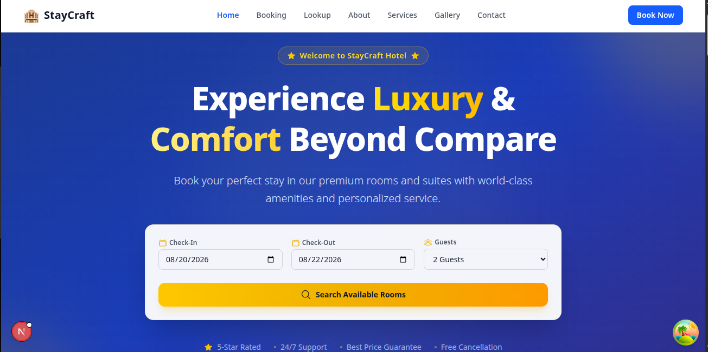
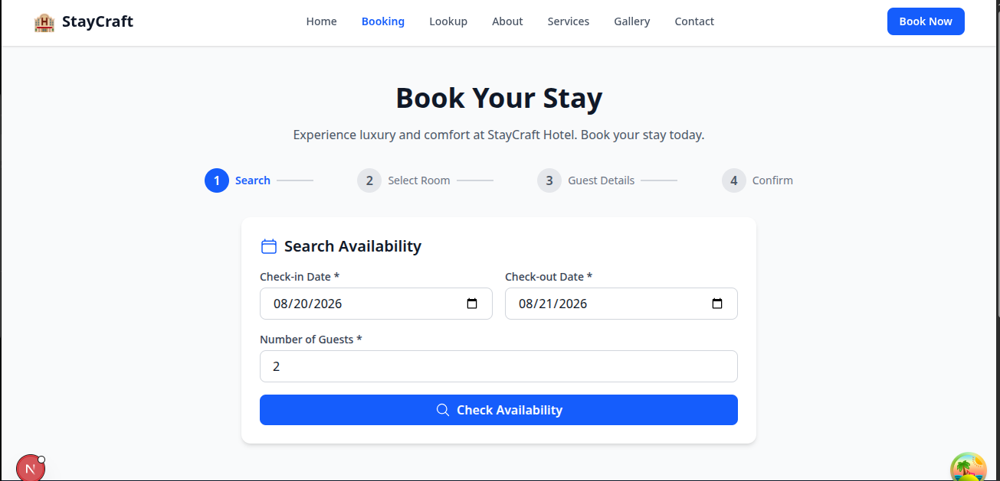

# 🏨 StayCraft Hotel & Room Management System — Frontend

<div align="center">

[](https://nextjs.org/)
[](https://www.typescriptlang.org/)
[](https://tailwindcss.com/)
[](https://reactjs.org/)
[](https://www.django-rest-framework.org/)
[](LICENSE)

<p align="center">
  A state-of-the-art, enterprise-grade Hotel & Bedroom Management Web Platform built with <b>Next.js App Router</b>, <b>TypeScript</b>, <b>Tailwind CSS</b>, and <b>Framer Motion</b>.
</p>

</div>

---

## 📸 Screenshots

### 🏨 Public Landing Page


### 🖥️ Booking Page


### 🛎️ Receptionist Dashboard


### 📱 Manager Dashboard


---


## 📖 Overview

**StayCraft Frontend** is a modern, responsive web application designed for hotel guests and hotel management teams. It provides a complete digital booking experience for guests—including room availability search, bank transfer payment proof uploads, and reservation tracking—as well as specialized operational dashboards for **Receptionists**, **Managers**, **Owners**, and **Administrators**.

---

## ✨ Features & Functionality

### 🌐 1. Public Guest Experience
- **Dynamic Hotel Landing Page**: Single-page overview displaying hotel profile, room categories, amenities, guest testimonials, photo gallery, corporate airline partners, and FAQs.
- **Online Room Search & Booking**: Real-time room availability filter by date range and guest count. Guests can submit reservations with uploaded bank transfer screenshot proof.
- **Stay Lookup**: Guests can check their booking confirmation and room status instantly using their phone number.
- **Contact & Inquiry System**: Public contact form connected directly to backend staff notifications.

### 🛎️ 2. Receptionist Portal (`/reception`)
- **Live Operations Board**: Real-time breakdown of occupied rooms, expected arrivals/departures today, and pending payment proof verification queue.
- **Walk-In Check-In**: Instant registration of walk-in guests, room allocation, security deposit recording, and key card assignment.
- **Reservation Check-In**: Process confirmed online bookings upon guest arrival.
- **Check-Out Processing**: Departure logging, extra charge calculation (mini-bar, damage fees), room cleaning status updates (`DIRTY_CLEANING`).
- **Payment Verification Workflow**: Staff inspect uploaded bank transfer screenshots, approve (dispatched guest SMS confirmation) or reject payment.
- **Stay Extensions (`ExtendStayModal`)**: Dynamically extend active stays with real-time room availability conflict checks and price recalculations.

### 📊 3. Manager Dashboard (`/manager`)
- **Room Inventory Management**: Complete CRUD operations for rooms, room types, pricing, and amenities.
- **Operational Oversight**: View live room statuses (*Available, Occupied, Cleaning, Maintenance*).
- **Staff Administration**: Manage receptionist accounts and monitor front desk activity.

### 👑 4. Owner & Executive Dashboard (`/owner`)
- **Executive Revenue KPIs**: Real-time metrics for total revenue, occupancy rate %, Average Daily Rate (ADR), and Revenue Per Available Room (RevPAR).
- **Staff Management**: Create staff accounts, filter by role (`RECEPTIONIST`, `MANAGER`, `OWNER`, `ADMIN`), and toggle account active status.
- **Financial Reports & Exports**: Export CSV reports for bookings, payments, and guest registers.

### 🔐 5. Authentication, Security & Middleware
- **JWT Authentication**: SimpleJWT integration with automatic token refreshing via Axios interceptors.
- **Next.js Server-Side Middleware Guard (`src/middleware.ts`)**: Automatic route protection enforcing role permissions:
  - `/owner/*` → Restricted to `OWNER` & `ADMIN`.
  - `/manager/*` → Restricted to `MANAGER`, `OWNER` & `ADMIN`.
  - `/reception/*` → Restricted to `RECEPTIONIST`, `MANAGER`, `OWNER` & `ADMIN`.
- **API Rewrites Proxy (`next.config.ts`)**: Bypasses CORS issues by proxying `/api/v1/*` requests to the Django REST backend.
- **1-Click Demo Login Credentials**: Quick auto-fill buttons on the login page for rapid multi-role testing.
- **Rate Limit & Brute-Force Alerting**: Graceful parsing of backend `429 Too Many Requests` status and 15-minute account lockout notices.

---

## 🔑 Demo Login Credentials

| Role | Username | Password | Dashboard Access |
| :--- | :--- | :--- | :--- |
| **Manager** | `manager` | `manager12345` | `/manager` |
| **Receptionist** | `receptionist1` | `receptionist12345` | `/reception` |
| **Owner** | `owner` | `owner12345` | `/owner` |
| **Admin** | `admin` | `admin12345` | `/owner` |

---

## 🛠️ Tech Stack

- **Framework**: Next.js 15/16 (App Router, Turbopack)
- **Language**: TypeScript 5.9
- **Styling**: Tailwind CSS 4.0, Framer Motion Animations
- **State Management**: Zustand (`authStore.ts`, `uiStore.ts`)
- **Form Handling**: React Hook Form, Zod Validation
- **HTTP Client**: Axios with Request/Response Interceptors
- **Notifications**: React Hot Toast
- **Icons**: Heroicons & Lucide React

---

## 📁 Directory Structure

```
booking-and-room-management-fr/
├── public/
│   └── images/                   # Static images (hero background, room previews)
├── src/
│   ├── app/
│   │   ├── (auth)/
│   │   │   └── login/            # Role login page with 1-click demo buttons
│   │   ├── (dashboard)/
│   │   │   ├── manager/          # Room inventory, amenities & staff management
│   │   │   ├── owner/            # Executive revenue analytics & staff creation
│   │   │   └── reception/        # Live board, check-in, check-out, bookings
│   │   ├── (public)/
│   │   │   ├── about/            # About hotel page
│   │   │   ├── booking/          # Room availability search & payment proof upload
│   │   │   ├── contact/          # Inquiry form page
│   │   │   ├── gallery/          # Full photo gallery showcase
│   │   │   ├── lookup/           # Stay status lookup by phone number
│   │   │   └── services/         # Amenities & services list
│   │   ├── globals.css           # Global Tailwind CSS styles
│   │   ├── layout.tsx            # Root HTML layout & Zustand providers
│   │   └── page.tsx              # Public landing homepage
│   ├── components/
│   │   ├── common/               # Header, Footer, Navbars
│   │   ├── modals/               # ExtendStayModal, PaymentProofModal
│   │   └── public/               # HeroSection, Amenities, Testimonials, Gallery, FAQ
│   ├── lib/
│   │   ├── api/                  # Axios HTTP client, endpoints & JWT interceptors
│   │   ├── providers.tsx         # Client context providers
│   │   └── store/                # Zustand stores (authStore & uiStore)
│   └── middleware.ts             # Next.js Server-Side Route Protection Guard
├── next.config.ts                # Next.js configuration & API proxy rewrites
├── package.json                  # Dependencies & npm scripts
├── tsconfig.json                 # TypeScript configuration
└── README.md                     # Project documentation
```

---

## 🚀 How to Clone & Run from GitHub

### 1. Clone the Repository
```bash
git clone https://github.com/DrLeroK/booking-and-room-management-fr.git
cd booking-and-room-management-fr
```

### 2. Install Dependencies
```bash
npm install
```

### 3. Configure Environment Variables
Create a `.env.local` file in the project root:
```env
NEXT_PUBLIC_API_URL=http://localhost:8000/api/v1
NEXT_PUBLIC_APP_NAME=StayCraft Grand Hotel
```

### 4. Ensure Backend is Running

NOTE - THERE IS A BACKEND FOR THIS FRONTEND IN THE REPO - https://github.com/DrLeroK/room_management_backend.git

### 5. Start Development Server
```bash
npm run dev
```

Open [http://localhost:3000](http://localhost:3000) in your browser.

---


## 🤝 Contributing

- Fork the repository
- Create your feature branch (git checkout -b feature/amazing-feature)
- Commit your changes (git commit -m 'Add some amazing feature')
- Push to the branch (git push origin feature/amazing-feature)
- Open a Pull Request

# 📄 License
This project is licensed under the MIT License - see the LICENSE file for details.

